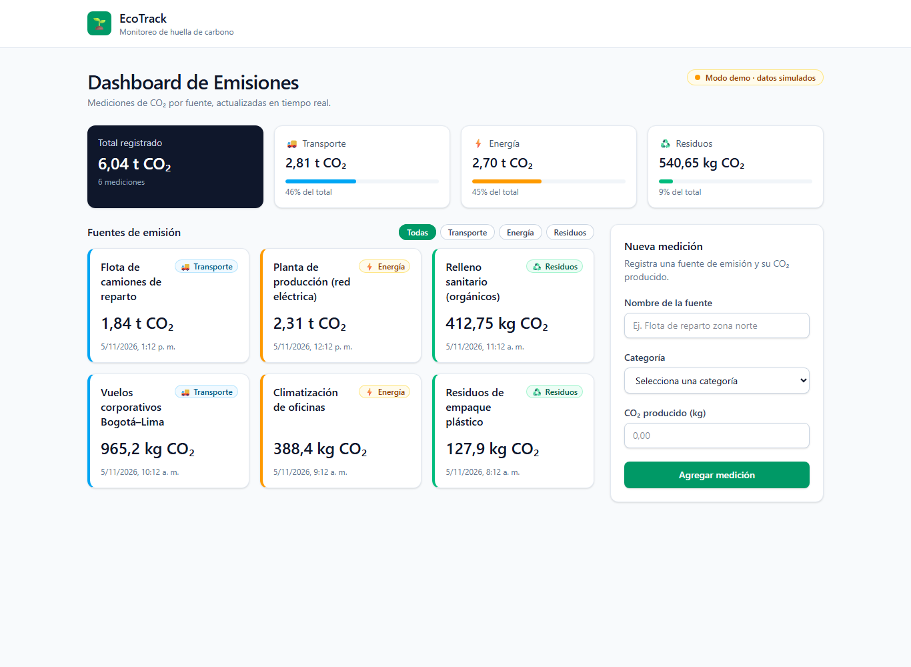
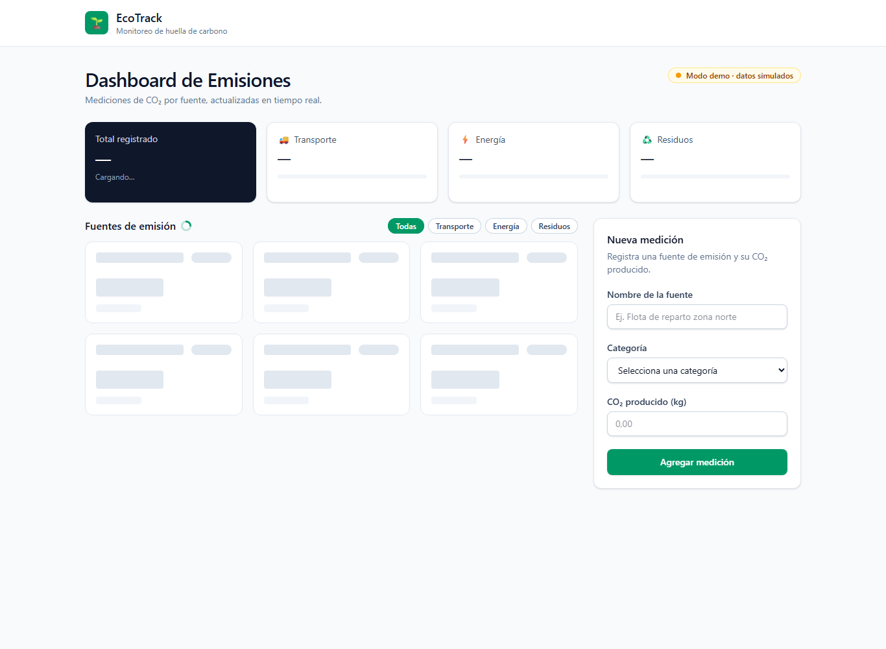
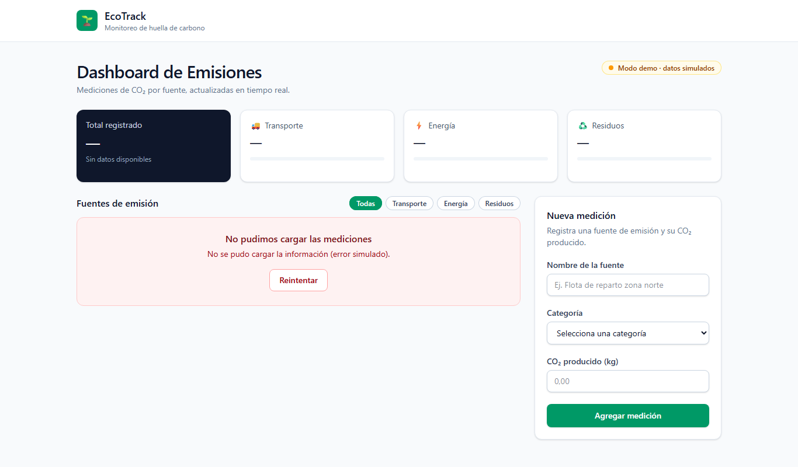
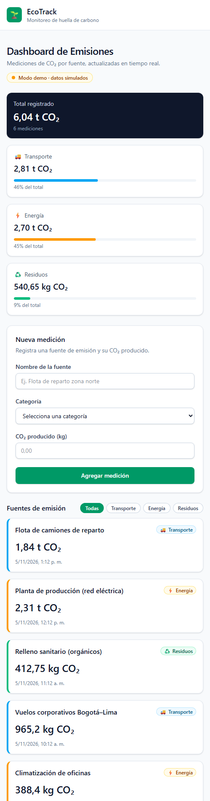

# EcoTrack · Dashboard de Emisiones en Tiempo Real

Núcleo de UI del laboratorio 3 (*Spec-to-Code*): componente `EmissionsTracker` en React + TypeScript
estricto, custom hook `useEmissions` conectado a Supabase y estilos con Tailwind CSS.



## Entregables

| Entregable | Ubicación |
|---|---|
| Bitácora de prompts | [`BITACORA_PROMPTS.md`](BITACORA_PROMPTS.md) |
| Componente principal | [`src/components/EmissionsTracker.tsx`](src/components/EmissionsTracker.tsx) |
| Custom hook | [`src/hooks/useEmissions.ts`](src/hooks/useEmissions.ts) |
| Configuración de Supabase | [`src/lib/supabase.ts`](src/lib/supabase.ts), [`supabase/schema.sql`](supabase/schema.sql), [`.env.example`](.env.example) |
| Capturas | [`docs/capturas/`](docs/capturas) |

## Arquitectura

```
EmissionsTracker  (presentación, filtro por categoría con useMemo)
 ├─ EmissionsSummary   tarjetas KPI (total y % por categoría)
 ├─ EmissionCard       memo · una por medición
 ├─ EmissionForm       memo · validación accesible
 └─ useEmissions       useReducer: carga / inserción / errores / realtime
      └─ EmissionsRepository  (interfaz)
           ├─ createSupabaseRepository   ← si hay credenciales en .env.local
           └─ createMockRepository       ← modo demo (datos simulados)
```

- La UI nunca importa Supabase: depende del hook, y el hook de una interfaz de repositorio.
- El repositorio traduce `snake_case` → `camelCase` y los errores de Postgres a mensajes en español.
- Supabase Realtime agrega en vivo las mediciones insertadas desde otros clientes (sin duplicados).

## Cómo ejecutarlo

```bash
npm install
npm run dev          # http://localhost:5173
```

Sin configuración arranca en **modo demo** con datos simulados. Para conectarlo a Supabase:

1. Crea un proyecto en [supabase.com](https://supabase.com) y ejecuta `supabase/schema.sql` en el SQL Editor
   (crea la tabla, las políticas RLS, habilita Realtime e inserta datos de ejemplo).
2. Copia `.env.example` a `.env.local` y completa `VITE_SUPABASE_URL` y `VITE_SUPABASE_ANON_KEY`.
3. Reinicia `npm run dev`: el indicador cambia a **"Conectado a Supabase · en vivo"**.

Para ver los estados de error en modo demo: `http://localhost:5173/?simularError=list` (carga) o
`?simularError=create` (al guardar).

## Scripts

| Comando | Qué hace |
|---|---|
| `npm run dev` | Servidor de desarrollo |
| `npm run build` | Typecheck estricto + build de producción |
| `npm test` | Pruebas del hook y la validación (Vitest + Testing Library) |
| `npm run preview` | Sirve el build |

## Capturas

| Carga (skeletons) | Error con reintento | Móvil |
|---|---|---|
|  |  |  |
